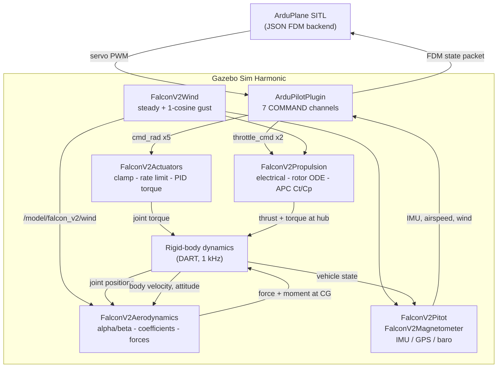

# FALCON V2

A physically-grounded Gazebo Sim Harmonic simulation of the FALCON V2
fixed-wing UAV, with full ArduPlane SITL integration.

The aircraft is modelled from real geometry, real manufacturer propeller data
and XFOIL/XFLR5-derived aerodynamic coefficients — not from coefficients tuned
until the aircraft happened to fly. Every numeric constant in the simulation is
loaded from a configuration file that records where it came from and how
confident that source is.

---

## Overview

FALCON V2 is a conventional-tail, twin-motor fixed-wing UAV with a 2.093 m
wingspan and a 6.000 kg all-up mass. This repository contains everything needed
to fly it in Gazebo under ArduPlane control:

- the SDF aircraft model (links, joints, mass/CG/inertia, collision geometry);
- five custom Gazebo system plugins (aerodynamics, propulsion, actuators, wind,
  sensors);
- the coefficient and parameter datasets those plugins load at runtime;
- the ArduPlane SITL parameter set and a launcher that connects both processes.

The design rule throughout is that physics lives in data, not in code. No
aerodynamic coefficient, motor constant or servo gain is hardcoded in C++ — the
plugins read `config/*.yaml` at `Configure()` time. Values that are genuinely
unknown are tagged `DATA_REQUIRED` rather than invented, and provisional
choices are tagged `V1_PROVISIONAL` or `ASSUMPTION` in place.

---

## Features

- **6-DOF powered flight simulation** in Gazebo Sim Harmonic.
- **ArduPlane SITL integration** over the JSON FDM backend, including an
  airspeed and wind bridge into the autopilot.
- **Aerodynamic force/moment model** with a full longitudinal and
  lateral-directional derivative set, a high-alpha limiter, and piecewise-linear
  wide-deflection control-surface lookup tables from an XFLR5 sweep.
- **Physically-modelled propulsion**: throttle → ESC/motor electrical → motor
  torque → rotor angular dynamics → RPM → advance ratio → real APC Ct/Cp data →
  thrust and torque, applied at the real hub locations. Never
  `throttle × max_thrust`.
- **Actuated control surfaces** driven by genuine joint torque with travel,
  slew-rate and effort limits — not kinematic position writes.
- **Simulated sensor suite**: IMU, GPS, barometer, plus custom pitot and
  magnetometer plugins.
- **Deterministic wind and 1-cosine gust generator** that publishes air-mass
  velocity, consumed consistently by the aerodynamics, propulsion and pitot
  models.

---

## Architecture



The actuator plugin is the only writer of control-surface joint motion; the
aerodynamics plugin only reads those joint positions. The wind plugin is the
only wind source and never applies a force itself — all wind effect reaches the
aircraft through `Vrel = Vbody − Vwind` in the aerodynamics, propulsion and
pitot models.

---

## Repository Structure

```text
falcon-v2/
├── config/               Runtime datasets loaded by the plugins
│   ├── ardupilot/        ArduPlane SITL parameter file
│   └── propulsion_data/  Raw + parsed APC propeller performance data
├── model/                SDF aircraft model and meshes
├── patches/              Required patch for ardupilot_gazebo
├── plugins/              Five Gazebo system plugins (C++)
│   ├── actuators/
│   ├── aerodynamics/
│   ├── propulsion/
│   ├── sensors/
│   └── wind/
├── scripts/              Build and launch helpers
├── worlds/               Gazebo world files
└── README.md
```

---

## Key Files

| Path | Purpose |
| ---- | ------- |
| `model/model.sdf` | The aircraft: 8 links, 7 joints, mass/CG/inertia, collision primitives, 4 sensors, and all six plugin declarations. |
| `model/model.config` | Gazebo model package descriptor. |
| `config/aero_v1_config.yaml` | Aerodynamic reference geometry, stability derivatives, drag polar, high-alpha limiter, control-surface lookup tables. |
| `config/propulsion_v1_config.yaml` | Motor, ESC, battery and propeller parameters; rotor inertia and RPM caps. |
| `config/actuator_v1_config.yaml` | Per-surface travel, slew rate, effort limits and PID gains. |
| `config/ardupilot/falcon_v2_sitl.parm` | ArduPlane SITL parameter set (servo functions, TECS, airspeed envelope, SITL origin). |
| `config/propulsion_data/PER3_13x65E.dat` | Official APC 13x6.5E performance data, unmodified. |
| `config/propulsion_data/apc_13x65e_parsed.csv` | The same data mechanically reformatted; what the plugin loads. |
| `config/propulsion_data/parse_apc_dat.py` | The parser that regenerates the CSV from the `.dat`. |
| `patches/ardupilot_gazebo_airspeed_wind_bridge.patch` | Adds `<airspeed_topic>` / `<wind_topic>` to ArduPilotPlugin. Required. |
| `worlds/falcon_v2_runway.sdf` | Runway world; the aircraft starts on the ground for takeoff. |
| `scripts/build_plugins.sh` | Builds all five plugins. |
| `scripts/launch_ardupilot_sitl.sh` | Starts Gazebo and ArduPlane SITL, connected. |

---

## Aircraft Model

| Property | Value |
| -------- | ----- |
| Mass | 6.000 kg |
| Wingspan | 2.093 m |
| Wing area | 0.4514 m² |
| Reference chord | 0.224 m |
| Centre of gravity | (0.168309, 0, 0.100000) m |
| Motors | 2 × SunnySky X2820 860KV |
| Propellers | 2 × APC 13x6.5E (D = 0.3302 m) |
| Battery | 4S, 14.8 V nominal |
| Control surfaces | 2 ailerons, 2 elevators, 1 rudder |
| Surface travel | ±45° mechanical |

**Coordinate frame.** The Gazebo body frame is **FLU**: +X forward, +Y left,
+Z up. The world frame is ENU. ArduPilot uses FRD body and NED world frames;
the conversions live in one place, `plugins/sensors/Frames.hh`, and are applied
explicitly — never by assumption.

**Structure.** `base_link` carries the airframe, motors and the sensor suite.
Five revolute joints carry the control surfaces and two carry the propellers.
Collision geometry is primitives only — three fuselage boxes, one box per wing,
one per motor nacelle, and a thin box per control surface. No high-poly STL is
used for collision, and the propellers have no collision geometry at all.

**Meshes.** The 12 STL visual meshes total roughly 143 MB and are not
distributed in this repository. Without them Gazebo will log missing-mesh
warnings and render nothing visible; **the physics, plugins and ArduPlane
integration are unaffected**, because mass, inertia, collision and all
aerodynamic geometry are numeric values in `model.sdf`, not mesh-derived. Place
the 12 files in `model/meshes/` to get visuals: `body.stl`, `left_wing.stl`,
`right_wing.stl`, `left_motor.stl`, `right_motor.stl`, `left_aileron.stl`,
`right_aileron.stl`, `left_elevator.stl`, `right_elevator.stl`, `rudder.stl`,
`left_pervane.stl`, `right_pervane.stl`.

---

## Aerodynamics

`plugins/aerodynamics/` computes the aerodynamic force and moment on
`base_link` every tick.

Each step reads body velocity, angular rates, attitude and the five
control-surface joint positions, subtracts the wind vector to get relative
airflow, and derives angle of attack and sideslip. The alpha and beta sign
conventions were derived from first principles for FLU rather than copied from
the standard FRD textbook forms, and are documented at the functions that
implement them in `plugins/aerodynamics/AeroModel.hh`.

Coefficients are built up from:

- **Longitudinal:** `CL0`, `CLa`, `CLq`, `Cm0`, `Cma`, `Cmq`.
- **Lateral-directional:** `CYb`, `Clb`, `Cnb`, `CYp`, `Clp`, `Cnp`, `CYr`,
  `Clr`, `Cnr`.
- **Drag:** a `CD0 + k·CL²` polar.
- **Control surfaces:** piecewise-linear lookup tables over 15 breakpoints from
  −45° to +45°, from an XFLR5 Type-1 fixed-condition wide-deflection sweep.

Two behaviours are worth knowing about. A high-alpha limiter saturates `CL`
past the attached-flow transition (9.25°) rather than extrapolating a linear
slope into stall. And every interpolation is domain-bounded: an input beyond
the first or last breakpoint returns that edge value exactly, never an
extrapolation.

Forces are computed in the wind frame and rotated into body axes; the moment is
applied about the CG. Diagnostics stream on
`/model/falcon_v2/aerodynamics/diagnostics`.

---

## Propulsion

`plugins/propulsion/` implements the full electro-mechanical chain per motor:

```
throttle  →  ESC/motor electrical (Kv, R, I0, current limit)
          →  motor torque
          →  rotor angular dynamics (explicit-Euler ODE state, integrated each tick)
          →  RPM  →  advance ratio J = V_axial / (n·D)
          →  APC Ct(J, RPM) / Cp(J, RPM)   [2-D interpolation over real data]
          →  thrust + propeller aerodynamic torque
          →  reaction torque
          →  wrench applied to base_link at the real hub location
```

The Ct/Cp data comes from APC's own published performance file for the 13x6.5E,
mechanically reformatted into CSV with no smoothing, extrapolation or invented
values — every returned coefficient is either a tabulated APC value or a linear
interpolation between two of them. The provenance chain is recorded in
`config/propulsion_data/PROVENANCE.md`, and the parser is included so the CSV
can be regenerated from the raw file.

Because the rotor state is a genuine ODE, throttle changes produce realistic
spool-up rather than instantaneous thrust. The same omega state drives the
propeller joints' visual rotation, so what you see always matches the RPM
actually producing force. Operating RPM is capped at 11500.

Airspeed effects are represented through the advance ratio: thrust falls off
with forward speed as the real propeller does.

---

## Control Surfaces

`plugins/actuators/` drives the five control-surface joints through three
stages:

1. **`ClampCommand()`** — clamp to the mechanical travel limit (±45°).
2. **`RateLimitSetpoint()`** — apply the servo slew-rate limit (300 °/s).
3. **`PidEffort()`** — an effort-bounded PID producing joint torque
   (0.20 N·m limit), applied with `gz::sim::Joint::SetForce()`.

Using torque rather than a position write matters: a position write would
teleport the joint past the physics engine and make the rate and effort limits
unenforceable. PID gains are derived against each surface's inertia about its
own hinge axis, parallel-axis corrected per surface. Integral action rejects
constant disturbances such as gravity on the surface without modelling them,
with anti-windup on target clamp, effort saturation and rate saturation.

The control-surface link masses are a deliberate near-massless placeholder, so
the plugin also sets physics-engine-level velocity and effort limits on each
joint with the same values, keeping motion bounded regardless of that
placeholder inertia.

Each surface takes an independent `gz.msgs.Double` command in physical radians
on `/model/falcon_v2/actuators/<surface>/cmd_rad`, defaulting to neutral and
holding the last valid command otherwise.

---

## ArduPlane SITL Integration

Gazebo and ArduPlane are connected by the official `ardupilot_gazebo`
`ArduPilotPlugin`, declared in `model/model.sdf`:

- **Transport:** UDP JSON on 127.0.0.1:9002, with `lock_step=1` for
  deterministic step-for-step synchronisation.
- **MAVLink:** ArduPlane's default SERIAL0 on TCP port 5760.
- **Command mapping:** 7 `COMMAND`-type channels fan ArduPlane's five logical
  servo outputs onto the project's seven command topics — SERVO1 (aileron, both
  sides with opposite sign), SERVO2 (elevator, both sides same sign), SERVO4
  (rudder), SERVO3 and SERVO5 (left and right throttle). `useForce=0` on every
  channel: ArduPlane never drives a joint directly.
- **Sensors in the loop:** a dedicated IMU relay sensor, plus airspeed and wind
  through the patched bridge. GPS, barometer and magnetometer are handled by
  ArduPilot's own JSON/FDM backend, which is standard behaviour.

Two details are easy to get wrong and are fixed here deliberately:

- `gazeboXYZToNED` is **overridden** to `"0 0 0 180 0 90"`. The plugin's
  compiled default silently swaps East and North for an ENU world.
- The ArduPilot-bridge IMU carries a 180°-about-X mounting rotation, because
  `CreateStateJSON()` writes raw gyro and accel into the FDM packet with no
  frame transform applied. Without it, raw FLU data reaches ArduPlane's
  FRD-assuming EKF and prearm fails with a DCM roll/pitch inconsistency.

The airspeed and wind bridge requires patching `ardupilot_gazebo` — see
Installation.

---

## Requirements

Developed and verified on:

| Component | Version |
| --------- | ------- |
| Ubuntu | 22.04 LTS |
| Gazebo Sim | Harmonic (gz-sim 8.14.0) |
| gz-plugin / gz-transport / gz-msgs / gz-math | 2.0.4 / 13.5.0 / 10.3.2 / 7.6.0 |
| yaml-cpp | 0.7.0 (`libyaml-cpp-dev`) |
| CMake | 3.22 (≥ 3.16 required) |
| Compiler | GCC 11.4 (C++17) |
| ArduPilot | ArduPlane, built for SITL |
| ardupilot_gazebo | patched, see below |

Nearby versions are likely to work, but have not been verified.

---

## Installation

**1. Install Gazebo Harmonic and build dependencies**

```bash
sudo apt update
sudo apt install gz-harmonic cmake build-essential libyaml-cpp-dev
```

**2. Build ArduPilot for SITL**

Follow the official ArduPilot SITL setup, then:

```bash
cd ~/ardupilot
./waf configure --board sitl
./waf plane
```

**3. Build ardupilot_gazebo with the airspeed/wind patch**

The patch adds the `<airspeed_topic>` and `<wind_topic>` elements this model
declares. It populates two keys that are already part of the official ArduPilot
SIM_JSON FDM protocol (`airspeed` and `velocity_wind`) — no protocol extension
is invented. Without it, ArduPlane derives airspeed from ground velocity and
zeroes the wind vector on every frame.

```bash
git clone https://github.com/ArduPilot/ardupilot_gazebo ~/ardupilot_gazebo
cd ~/ardupilot_gazebo
git apply /path/to/falcon-v2/patches/ardupilot_gazebo_airspeed_wind_bridge.patch
cmake -S . -B build -DCMAKE_BUILD_TYPE=Release
cmake --build build -j$(nproc)
```

**4. Clone this repository and build its plugins**

```bash
git clone <repository-url> falcon-v2
cd falcon-v2
./scripts/build_plugins.sh
```

**5. Add the aircraft meshes** (optional, visuals only)

Place the 12 STL files listed under [Aircraft Model](#aircraft-model) in
`model/meshes/`.

---

## Build

```bash
./scripts/build_plugins.sh              # Release (default)
./scripts/build_plugins.sh Debug        # or a specific CMake build type
```

Each plugin is an independent CMake project built into its own
`plugins/<name>/build/` directory, which is where the launch script expects the
shared libraries. To build one on its own:

```bash
cmake -S plugins/aerodynamics -B plugins/aerodynamics/build -DCMAKE_BUILD_TYPE=Release
cmake --build plugins/aerodynamics/build -j$(nproc)
```

A successful build produces six shared libraries:
`libFalconV2Aerodynamics.so`, `libFalconV2Propulsion.so`,
`libFalconV2Actuators.so`, `libFalconV2Wind.so`, `libFalconV2Pitot.so`,
`libFalconV2Magnetometer.so`.

---

## Running

```bash
./scripts/launch_ardupilot_sitl.sh --gui
```

This starts Gazebo with the runway world and ArduPlane SITL, connected to each
other. It arms nothing and changes no flight mode — it only brings both
processes up. Connect a ground station in another terminal:

```bash
mavproxy.py --master=tcp:127.0.0.1:5760
```

Options:

```bash
./scripts/launch_ardupilot_sitl.sh                    # headless
./scripts/launch_ardupilot_sitl.sh --gui              # with the Gazebo GUI
./scripts/launch_ardupilot_sitl.sh worlds/other.sdf   # different world
```

If ArduPilot lives somewhere other than `~/gazebo_sim/`, point the script at it:

```bash
ARDUPILOT_ROOT=~/ardupilot \
ARDUPILOT_GAZEBO_BUILD=~/ardupilot_gazebo/build \
./scripts/launch_ardupilot_sitl.sh --gui
```

Press Ctrl+C to stop both processes cleanly.

### Driving the model directly

The plugins can also be exercised without ArduPlane:

```bash
# Throttle both motors to 50 %
gz topic -t /model/falcon_v2/propulsion/left/throttle_cmd  -m gz.msgs.Double -p "data: 0.5"
gz topic -t /model/falcon_v2/propulsion/right/throttle_cmd -m gz.msgs.Double -p "data: 0.5"

# Deflect the ailerons ±10°
gz topic -t /model/falcon_v2/actuators/left_aileron/cmd_rad  -m gz.msgs.Double -p "data:  0.1745"
gz topic -t /model/falcon_v2/actuators/right_aileron/cmd_rad -m gz.msgs.Double -p "data: -0.1745"

# Set a 5 m/s steady wind along world +X
gz topic -t /model/falcon_v2/wind/steady_cmd -m gz.msgs.Vector3d -p "x: 5.0, y: 0.0, z: 0.0"

# Watch the aerodynamic state
gz topic -e -t /model/falcon_v2/aerodynamics/diagnostics
```

**Note:** Gazebo must be launched from the repository root. The
`<config_path>` entries in `model/model.sdf` are repository-relative; the
launch script handles this for you.

---

## Configuration

| File | What you can change |
| ---- | ------------------- |
| `config/aero_v1_config.yaml` | Air density, reference geometry, stability derivatives, drag polar, high-alpha limiter, control-surface lookup tables. |
| `config/propulsion_v1_config.yaml` | Motor Kv/resistance/no-load current, battery voltage, propeller diameter, rotor inertia, RPM caps, rotation signs. |
| `config/actuator_v1_config.yaml` | Per-surface travel limits, slew rate, effort limit, PID gains. |
| `config/ardupilot/falcon_v2_sitl.parm` | ArduPlane parameters: servo functions and travel, TECS tuning, airspeed envelope, SITL origin and datum. |
| `worlds/falcon_v2_runway.sdf` | Spawn pose, ground friction, gravity, timestep, magnetic field, spherical datum. |
| `model/model.sdf` | Plugin parameters: diagnostics rates, topic names, air-density overrides, ArduPilot channel mapping. |

Each entry in the YAML files carries a provenance tag — `CONFIRMED`,
`DERIVED`, `V1_PROVISIONAL`, `ASSUMPTION` or `DATA_REQUIRED` — saying where the
number came from and how much weight it can bear. Read the tag before changing
a value.

---

## Known Limitations

These are properties of the V1 model, all traceable to the configuration and
source in this repository:

- **Constant air density.** ρ is fixed at 1.225 kg/m³ (ISA sea level)
  throughout. There is no altitude or temperature model, so equivalent and true
  airspeed are identical by construction.
- **No battery model.** Pack voltage is fixed at 14.8 V nominal. Internal
  resistance, state-of-charge and the discharge curve are `DATA_REQUIRED`.
- **Aerodynamic validity beyond ±10°.** The control-surface lookup tables cover
  ±45°, but the underlying XFLR5 sweeps are most directly validated near ±10°.
  Large deflections will move the joints and produce forces, but those forces
  carry less confidence.
- **No hinge moments.** Aerodynamic loads are applied to `base_link` only; no
  reaction torque is fed back onto the individual control-surface joints.
  Per-surface hinge-moment data is `DATA_REQUIRED`. Actuator behaviour under
  real aerodynamic load is therefore not represented.
- **Placeholder control-surface masses.** Each movable surface carries a
  numerical placeholder mass of 0.001 kg; component-level mass data does not
  exist for these parts. Physics-engine velocity and effort limits compensate.
- **Provisional servo specification.** Slew rate (300 °/s) and effort
  (0.20 N·m) are conservative order-of-magnitude choices, not datasheet values.
- **Single gust.** Only one 1-cosine gust may be scheduled or in progress at a
  time; a new command replaces any existing one. Spatial wind gradients, terrain
  and wake effects, and stochastic (Dryden/Von Karman) turbulence are not
  modelled.
- **Simulation-only pitot.** The real airframe flew without an airspeed sensor.
  The pitot model is a scalar dynamic-pressure model with no reverse-flow,
  compressibility or installation-error correction.
- **Custom magnetometer.** The native `gz-sim-magnetometer-system` on the
  targeted Gazebo build publishes a constant field that ignores the world's
  `<magnetic_field>` value, so this project ships its own plugin. The Earth
  field vector is a documented simulation assumption.
- **Unverified sign conventions.** The alpha/beta signs are derived from first
  principles for FLU but are not confirmed against XFLR5's own internal
  convention. Propeller rotation direction is recorded as left CCW / right CW,
  but the source data states no viewing frame, so that detail remains
  `DATA_REQUIRED`.
- **Unverified inertia cross-term.** The `Ixz` off-diagonal sign convention
  against SDF's expectation is explicitly flagged rather than silently resolved.
- **Repository-relative config paths.** Gazebo must run with the repository root
  as its working directory.
- **Meshes not distributed.** See [Aircraft Model](#aircraft-model).

---

## V1 Scope

V1 delivers a complete, flyable aircraft: full 6-DOF rigid-body dynamics,
aerodynamics with the complete stability-derivative set, a physically-modelled
twin propulsion chain on real manufacturer propeller data, torque-driven
control surfaces, a simulated sensor suite, deterministic wind and gusts, and
closed-loop flight under ArduPlane SITL from runway takeoff onward.

It is deliberately a constant-density, rigid-airframe, single-gust model with no
hinge-moment feedback and no battery discharge behaviour. Those are the natural
V2 boundaries, and the configuration files mark exactly which data would be
needed to cross them.
