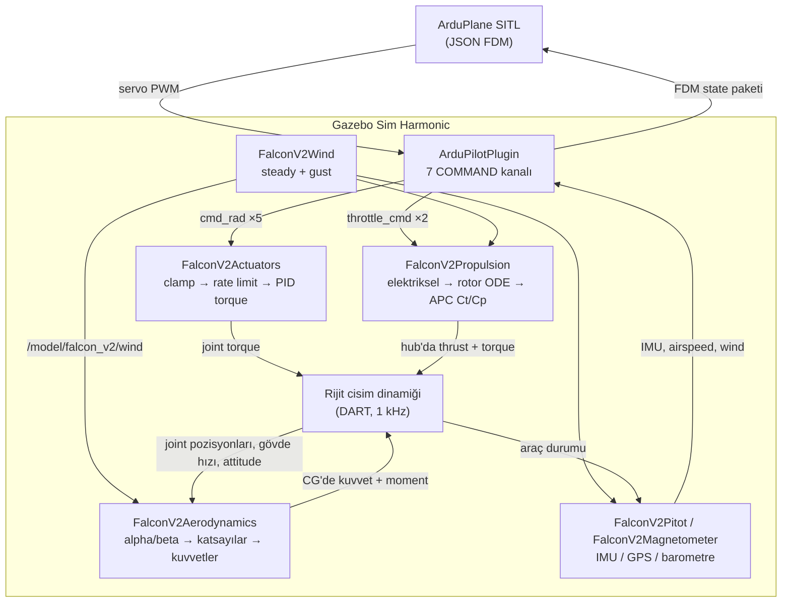

# FALCON V2

FALCON V2 sabit kanatlı İHA'sının Gazebo Sim Harmonic üzerinde çalışan 6-DOF
uçuş simülasyonu ve ArduPlane SITL entegrasyonu.

## Genel Bakış

Uçak; gerçek CAD geometrisi, üretici propeller verisi ve XFOIL/XFLR5 kaynaklı
aerodinamik katsayılarla modellenmiştir. Amaç uçak "uçana kadar" katsayı
ayarlamak değil, eldeki mühendislik verisinin tanımladığı uçağı olabildiğince
doğru yeniden üretmektir.

Temel kural: **fizik kodda değil, veride yaşar.** Hiçbir aerodinamik katsayı,
motor sabiti veya servo kazancı C++ içine gömülü değildir; plugin'ler `config/`
altındaki dosyaları çalışma anında okur. Bilinmeyen değerler uydurulmaz,
`DATA_REQUIRED` olarak işaretlenir; geçici seçimler `V1_PROVISIONAL` veya
`ASSUMPTION` etiketiyle yerinde belirtilir.

## Özellikler

- Gazebo Sim Harmonic üzerinde tam 6-DOF motorlu uçuş
- ArduPlane SITL entegrasyonu (JSON FDM), airspeed ve wind bridge dahil
- Tam longitudinal + lateral-directional stability derivative seti, high-alpha
  limiter, XFLR5 wide-deflection lookup tabloları
- Gerçek APC performans verisi üzerinden thrust/torque — asla `throttle × max_thrust`
- Gerçek joint torque ile sürülen, travel/rate/effort limitli kontrol yüzeyleri
- Simüle sensör seti: IMU, GPS, barometre, pitot, magnetometre
- Deterministik steady wind ve 1-cosine gust üreteci

## Sistem Mimarisi



Kontrol yüzeyi hareketini yalnızca actuator plugin'i yazar; aerodinamik plugin o
joint pozisyonlarını sadece okur. Wind plugin'i tek rüzgâr kaynağıdır ve kendisi
hiçbir zaman kuvvet uygulamaz — rüzgârın etkisi uçağa yalnızca aerodinamik, itki
ve pitot modellerindeki `Vrel = Vbody − Vwind` üzerinden ulaşır.

## Repository Yapısı

```text
falcon-v2/
├── config/               Plugin'lerin runtime'da okuduğu veri setleri
│   ├── ardupilot/        ArduPlane SITL parametre dosyası
│   └── propulsion_data/  Ham ve parse edilmiş APC propeller verisi
├── model/                SDF uçak modeli ve mesh'ler
├── patches/              ardupilot_gazebo için gerekli patch
├── plugins/              Beş Gazebo system plugin'i (C++)
├── scripts/              Build ve launch yardımcıları
└── worlds/               Gazebo world dosyaları
```

## Uçak Modeli

| Özellik | Değer |
| ------- | ----- |
| Kütle | 6.000 kg |
| Kanat açıklığı | 2.093 m |
| Kanat alanı | 0.4514 m² |
| Referans veter | 0.224 m |
| Ağırlık merkezi | (0.168309, 0, 0.100000) m |
| Motorlar | 2 × SunnySky X2820 860KV |
| Pervaneler | 2 × APC 13x6.5E (D = 0.3302 m) |
| Batarya | 4S, 14.8 V nominal |
| Kontrol yüzeyleri | 2 aileron, 2 elevator, 1 rudder (±45° mekanik) |

**Koordinat sistemi.** Gazebo gövde çerçevesi **FLU**'dur (+X ileri, +Y sol,
+Z yukarı), world çerçevesi ENU'dur. ArduPilot FRD gövde ve NED world kullanır;
dönüşümler tek bir yerde, `plugins/sensors/Frames.hh` içinde tanımlıdır ve her
zaman açıkça uygulanır — asla varsayımla geçilmez.

**Yapı.** `base_link` gövdeyi, motorları ve sensörleri taşır. Beş revolute joint
kontrol yüzeylerini, iki tanesi pervaneleri taşır. Collision geometrisi yalnızca
primitiflerden oluşur (gövde için üç kutu, kanat/motor/yüzey başına birer kutu);
hiçbir yerde yüksek poligonlu STL collision olarak kullanılmaz, pervanelerin
collision'ı hiç yoktur.

**Mesh'ler.** 12 STL görsel mesh ~143 MB tutar ve bu repository ile dağıtılmaz.
Onlar olmadan Gazebo görsel çizmez, ancak **fizik ve entegrasyon etkilenmez**:
kütle, atalet, collision ve tüm aerodinamik geometri `model/model.sdf` içinde sayısal
değerlerdir, mesh'ten türetilmez.

## Aerodinamik Model

`plugins/aerodynamics/` her tick'te `base_link` üzerindeki kuvvet ve momenti
hesaplar. Gövde hızı, açısal hızlar, attitude ve beş joint pozisyonu okunur;
rüzgâr çıkarılarak bağıl hava akışı, oradan alpha ve beta türetilir. Alpha/beta
işaret konvansiyonları standart FRD formlarından kopyalanmamış, FLU için ilk
ilkelerden türetilmiş ve `plugins/aerodynamics/AeroModel.hh` içinde ilgili fonksiyonların başında
belgelenmiştir.

Katsayı yapısı:

- **Longitudinal:** `CL0`, `CLa`, `CLq`, `Cm0`, `Cma`, `Cmq`
- **Lateral-directional:** `CYb`, `Clb`, `Cnb`, `CYp`, `Clp`, `Cnp`, `CYr`, `Clr`, `Cnr`
- **Sürükleme:** `CD0 + k·CL²` drag polar
- **Kontrol yüzeyleri:** −45°…+45° arası 15 breakpoint üzerinde parçalı doğrusal
  lookup tabloları (XFLR5 Type-1 wide-deflection sweep)

High-alpha limiter, attached-flow geçişinden (9.25°) sonra `CL`'i doğrusal eğimle
stall'a ekstrapole etmek yerine doyurur. Her interpolasyon domain-bounded'dır:
uç breakpoint dışındaki girdi tam olarak o uç değeri döndürür, asla ekstrapole
edilmez. Kuvvetler wind frame'de hesaplanıp gövde eksenlerine döndürülür; moment
CG etrafında uygulanır.

## İtki Sistemi

`plugins/propulsion/` her motor için tam elektromekanik zinciri uygular:

```
throttle → ESC/motor elektriksel (Kv, R, I0, akım limiti)
         → motor torku
         → rotor açısal dinamiği (explicit-Euler ODE, her tick entegre edilir)
         → RPM → advance ratio J = V_axial / (n·D)
         → APC Ct(J, RPM) / Cp(J, RPM)   [gerçek veri üzerinde 2-B interpolasyon]
         → thrust + propeller aerodinamik torku → reaction torque
         → gerçek hub konumunda base_link'e uygulanan wrench
```

Ct/Cp verisi APC'nin 13x6.5E için yayımladığı resmî performans dosyasından gelir;
yumuşatma veya ekstrapolasyon olmadan CSV'ye dönüştürülmüştür. Dönen her katsayı
ya tablodaki gerçek bir APC değeridir ya da iki gerçek değer arasında doğrusal
interpolasyondur. Sağlama zinciri `config/propulsion_data/PROVENANCE.md` içinde
kayıtlı, CSV'yi ham dosyadan yeniden üreten parser de repoda.

Rotor durumu gerçek bir ODE olduğundan throttle değişimi anlık thrust yerine
gerçekçi spool-up üretir. Aynı omega durumu pervanelerin görsel dönüşünü de
sürer, böylece görülen dönüş kuvveti üreten RPM ile daima aynıdır. İşletme RPM'i
11500'de sınırlıdır; airspeed etkisi advance ratio üzerinden temsil edilir.

## Kontrol ve ArduPlane Entegrasyonu

`plugins/actuators/` beş kontrol yüzeyini üç aşamada sürer:

1. **`ClampCommand()`** — mekanik hareket limitine (±45°) kırp
2. **`RateLimitSetpoint()`** — servo slew-rate limitini uygula (300 °/s)
3. **`PidEffort()`** — effort sınırlı PID ile joint torku üret (0.20 N·m),
   `gz::sim::Joint::SetForce()` ile uygula

Pozisyon yazmak yerine tork kullanmak kritiktir: pozisyon yazımı joint'i fizik
motorunu atlayarak ışınlar ve rate/effort limitlerini uygulanamaz hâle getirir.
PID kazançları her yüzeyin kendi menteşe ekseni etrafındaki ataletine göre,
yüzey başına parallel-axis düzeltmesiyle türetilmiştir.

Gazebo ile ArduPlane, `model/model.sdf` içinde tanımlı resmî `ardupilot_gazebo`
`ArduPilotPlugin` üzerinden bağlanır: 127.0.0.1:9002 UDP JSON, deterministik
adım eşlemesi için `lock_step=1`. Yedi `COMMAND` tipi kanal, ArduPlane'in beş
mantıksal servo çıkışını projenin yedi komut topic'ine dağıtır — SERVO1
(aileron, iki taraf ters işaretli), SERVO2 (elevator, aynı işaretli), SERVO4
(rudder), SERVO3/SERVO5 (sol/sağ throttle). Her kanalda `useForce=0`: ArduPlane
hiçbir joint'i doğrudan sürmez.

Kolayca gözden kaçan iki nokta bilinçli olarak düzeltilmiştir:

- `gazeboXYZToNED` değeri `"0 0 0 180 0 90"` ile **ezilir**; plugin'in derlenmiş
  varsayılanı ENU bir world için East ve North'u sessizce yer değiştirir.
- ArduPilot bridge IMU'su 180°'lik X ekseni montaj dönüşü taşır, çünkü
  `CreateStateJSON()` ham gyro/accel değerlerini FDM paketine hiçbir çerçeve
  dönüşümü uygulamadan yazar. Bu dönüş olmadan ham FLU verisi ArduPlane'in FRD
  varsayan EKF'ine ulaşır ve prearm, DCM roll/pitch tutarsızlığıyla başarısız olur.

## Önemli Dosyalar

| Dosya | Amaç |
| ----- | ---- |
| `model/model.sdf` | Uçak: 8 link, 7 joint, kütle/CG/atalet, collision primitifleri, 4 sensör, tüm plugin tanımları |
| `config/aero_v1_config.yaml` | Referans geometri, stability derivative'ler, drag polar, high-alpha limiter, lookup tabloları |
| `config/propulsion_v1_config.yaml` | Motor, ESC, batarya ve pervane parametreleri; rotor ataleti, RPM limitleri |
| `config/actuator_v1_config.yaml` | Yüzey başına hareket, slew rate, effort limitleri, PID kazançları |
| `config/ardupilot/falcon_v2_sitl.parm` | ArduPlane SITL parametre seti (servo fonksiyonları, TECS, airspeed zarfı, SITL origin) |
| `config/propulsion_data/PER3_13x65E.dat` | APC 13x6.5E resmî performans verisi, değiştirilmemiş |
| `config/propulsion_data/apc_13x65e_parsed.csv` | Aynı verinin CSV hâli; plugin'in okuduğu dosya |
| `patches/ardupilot_gazebo_airspeed_wind_bridge.patch` | ArduPilotPlugin'e `<airspeed_topic>` / `<wind_topic>` ekler (zorunlu) |
| `worlds/falcon_v2_runway.sdf` | Pist dünyası; uçak kalkış için yerde başlar |
| `scripts/launch_ardupilot_sitl.sh` | Gazebo ve ArduPlane SITL'i bağlı şekilde başlatır |

## V1 Kapsamı ve Bilinen Sınırlamalar

V1 uçurulabilir eksiksiz bir uçak sunar: tam 6-DOF dinamik, tüm stability
derivative setiyle aerodinamik, gerçek pervane verisine dayalı çift itki zinciri,
torkla sürülen kontrol yüzeyleri, simüle sensör seti, deterministik rüzgâr/gust
ve ArduPlane SITL altında pistten kalkıştan itibaren kapalı çevrim uçuş.

Bilinen sınırlamalar:

- **Sabit hava yoğunluğu** — ρ her yerde 1.225 kg/m³ (ISA deniz seviyesi).
  İrtifa/sıcaklık modeli yok; EAS ile TAS yapısal olarak özdeş.
- **Batarya modeli yok** — voltaj 14.8 V'ta sabit; iç direnç, şarj durumu ve
  deşarj eğrisi `DATA_REQUIRED`.
- **±10° ötesinde aerodinamik geçerlilik** — lookup tabloları ±45°'yi kapsar,
  ancak altındaki XFLR5 sweep'leri en doğrudan ±10° civarında doğrulanmıştır.
- **Menteşe momenti yok** — aerodinamik yükler yalnızca `base_link`'e uygulanır;
  yüzey joint'lerine reaksiyon torku geri beslenmez (`DATA_REQUIRED`).
- **Yer tutucu yüzey kütleleri** — her hareketli yüzey 0.001 kg sayısal yer tutucu
  taşır; fizik motoru seviyesindeki hız/effort limitleri bunu telafi eder.
- **Geçici servo spesifikasyonu** — slew rate (300 °/s) ve effort (0.20 N·m)
  datasheet değeri değil, muhafazakâr mertebe seçimleri.
- **Tek gust** — aynı anda yalnızca bir 1-cosine gust. Uzamsal rüzgâr gradyanları,
  arazi/iz etkileri ve stokastik türbülans modellenmemiş.
- **Simülasyona özgü pitot** — gerçek uçak airspeed sensörsüz uçtu. Model; ters
  akış, sıkıştırılabilirlik ve montaj hatası düzeltmesi içermez.
- **Özel magnetometre** — hedeflenen Gazebo sürümündeki yerleşik
  `gz-sim-magnetometer-system` world'ün `<magnetic_field>` değerini yok sayar.
- **Doğrulanmamış işaret konvansiyonları** — alpha/beta XFLR5'in iç
  konvansiyonuna karşı teyit edilmedi; pervane dönüş yönü için kaynak veri bakış
  çerçevesi belirtmediğinden bu ayrıntı `DATA_REQUIRED`.
- **Doğrulanmamış `Ixz`** — çapraz terimin SDF beklentisine göre işareti sessizce
  çözülmek yerine açıkça işaretlenmiştir.
- **Mesh'ler dağıtılmıyor** — bkz. [Uçak Modeli](#uçak-modeli).
