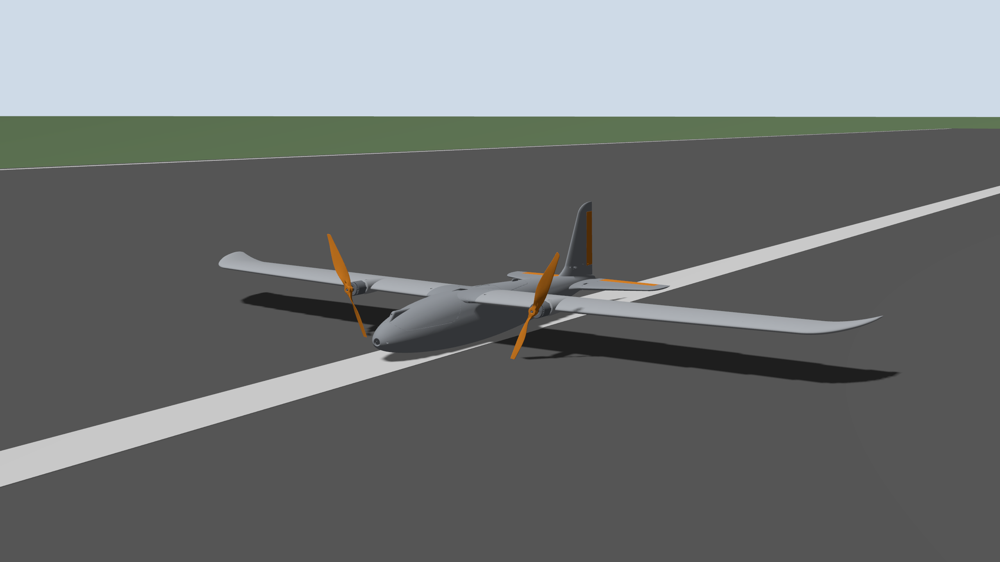
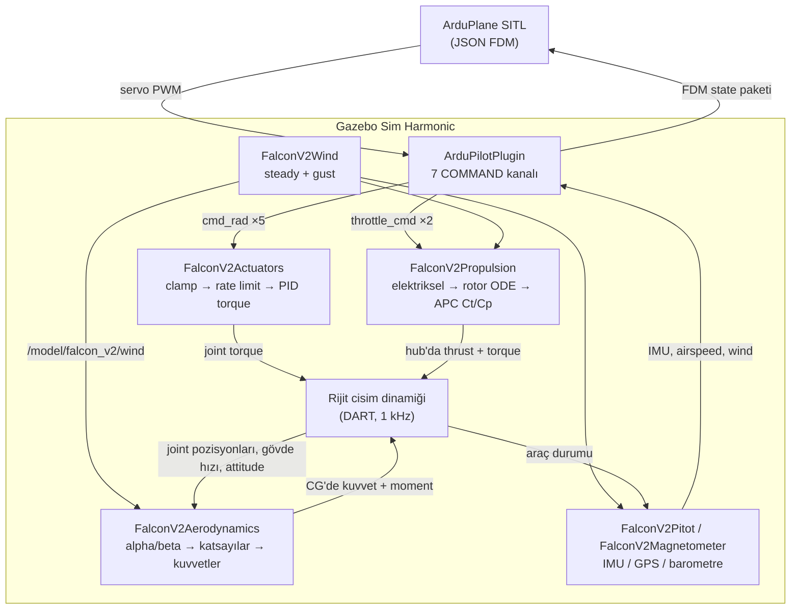
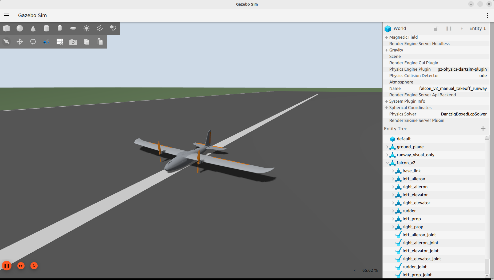
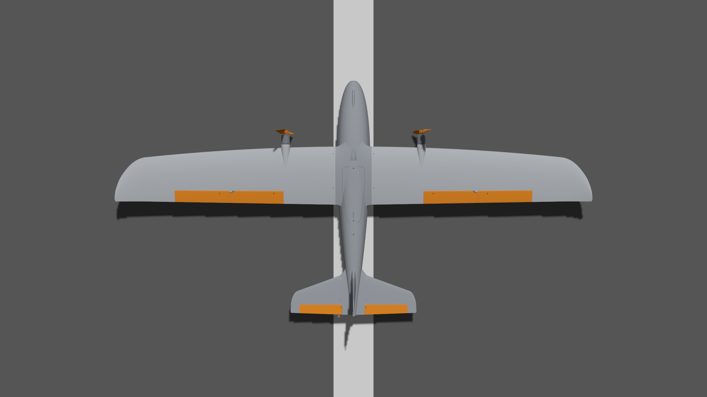
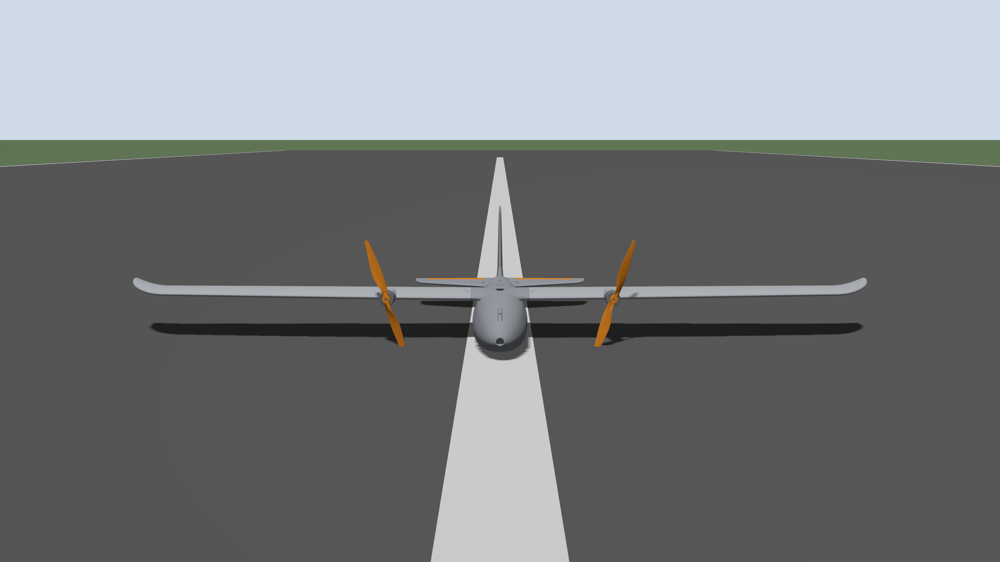
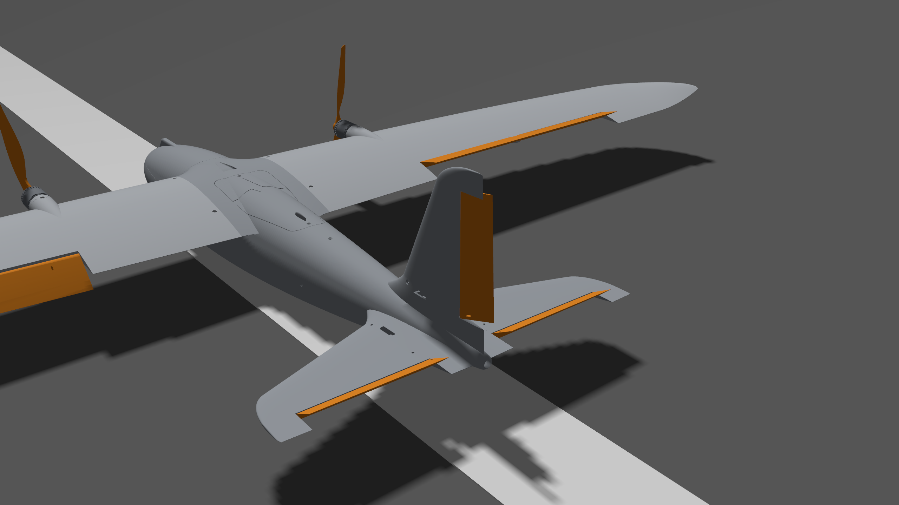
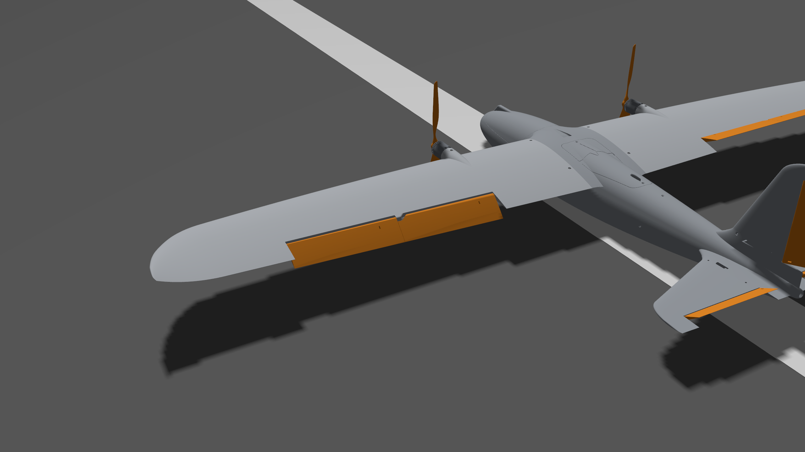
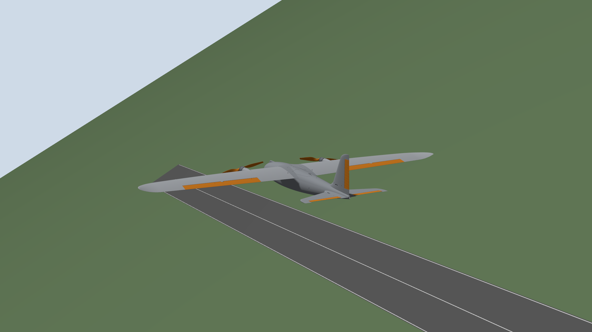

<div align="center">

# FALCON V2

**Sabit kanatlı bir İHA'nın Gazebo Sim Harmonic üzerinde çalışan 6-DOF uçuş simülasyonu ve ArduPlane SITL entegrasyonu.**




</div>

---

Bu depo, gerçek bir uçağın simülasyonunu yazılım problemi olarak ele alır: aerodinamik,
itki, aktüatör ve sensör davranışı beş ayrı Gazebo **system plugin**'i hâlinde C++
ile yazılmıştır; her birinin kendi sınırı, kendi veri dosyası ve kendi runtime
arayüzü vardır.

Amaç uçak "uçana kadar" katsayı ayarlamak değildi. Elde XFOIL/XFLR5 analizleri,
üretici pervane performans verisi ve gerçek CAD geometrisi vardı — hedef, o verinin
tanımladığı uçağı olabildiğince sadık biçimde yeniden üretmekti. Bu, mimariyi
doğrudan şekillendiren bir kısıt oldu.

## Öne Çıkanlar

- **Beş bağımsız C++ plugin** — aerodinamik, itki, aktüatör, rüzgâr, sensörler.
  Her biri ayrı bir CMake projesi, ayrı bir `.so`.
- **Fizik kodda değil veride.** Hiçbir aerodinamik katsayı, motor sabiti veya servo
  kazancı C++ içine gömülü değil; plugin'ler `config/` altındaki dosyaları
  `Configure()` anında okur.
- **Saf matematik çekirdeği Gazebo'dan ayrık.** `AeroModel.hh`, `PropulsionModel.hh`,
  `ActuatorModel.hh` — Gazebo bağımlılığı olmayan, tek başına test edilebilir header'lar.
  Plugin sınıfları yalnızca durum okur, çekirdeği çağırır, sonucu uygular.
- **ArduPlane SITL entegrasyonu** — JSON FDM üzerinden kapalı çevrim uçuş,
  `lock_step` ile deterministik adım eşlemesi, airspeed ve wind bridge dahil.
- **Her sayının kaynağı belli.** Kaynağı olmayan değer uydurulmaz; `ASSUMPTION`,
  `TEMPORARY` veya `DATA_REQUIRED` olarak işaretlenir.
- **Ölçülmüş doğrulama kaydı** — [`docs/validation/`](docs/validation/) altında,
  çalışan simülasyondan alınmış gerçek veriye dayanan raporlar.

## Sistem Mimarisi



Mimarinin taşıdığı iki kural, hata ayıklamayı mümkün kılan şey oldu:

**Tek yazar kuralı.** Kontrol yüzeyi hareketini yalnızca actuator plugin'i yazar;
aerodinamik plugin o joint pozisyonlarını sadece okur. Böylece bir yüzeyin neden
o açıda olduğunun tek bir cevabı olur.

**Rüzgâr kuvvet uygulamaz.** Wind plugin'i tek rüzgâr kaynağıdır ve hiçbir zaman
`AddWorldForce` çağırmaz — yalnızca bir hız vektörü yayınlar. Rüzgârın etkisi uçağa
yalnızca aerodinamik, itki ve pitot modellerindeki `Vrel = Vbody − Vwind` üzerinden
ulaşır. Aynı etkiyi iki yerden uygulayıp sessizce ikiye katlamak bu yüzden mümkün değil.



<sub>Gazebo Sim Harmonic, ArduPlane SITL bağlıyken. Sağ panelde modelin 8 link'i ve 7 joint'i, altta DART fizik motoru.</sub>

## Plugin'ler

| Plugin | Kütüphane | Sorumluluk | Saf çekirdek |
| ------ | --------- | ---------- | ------------ |
| [`aerodynamics`](plugins/aerodynamics/) | `libFalconV2Aerodynamics.so` | Gövdeye uygulanan aerodinamik kuvvet ve moment | `AeroModel.hh` |
| [`propulsion`](plugins/propulsion/) | `libFalconV2Propulsion.so` | Çift motor/ESC/pervane zinciri, thrust ve torque | `PropulsionModel.hh` |
| [`actuators`](plugins/actuators/) | `libFalconV2Actuators.so` | Beş kontrol yüzeyinin servo dinamiği | `ActuatorModel.hh` |
| [`wind`](plugins/wind/) | `libFalconV2Wind.so` | Steady rüzgâr ve 1-cosine gust üreteci | `WindModel.hh` |
| [`sensors`](plugins/sensors/) | `libFalconV2Pitot.so`, `libFalconV2Magnetometer.so` | Pitot airspeed, özel magnetometre | `PitotModel.hh`, `Frames.hh` |

Her plugin kendi `README.md`'si ile birlikte gelir. Ortak kalıp aynı: Gazebo'ya
bağımlı ince bir `System` sınıfı, ve onun çağırdığı Gazebo'dan bağımsız saf bir
matematik header'ı. Katsayı bu header'ların içinde değil, YAML'de yaşar.

## Veriden Sürülen Tasarım

Projeyi şekillendiren tek kural şu: **bir sayı koda gömülüyse kaynağı kaybolur.**

```
config/aero_v1_config.yaml          →  FalconV2Aerodynamics
config/propulsion_v1_config.yaml    →  FalconV2Propulsion
config/actuator_v1_config.yaml      →  FalconV2Actuators
config/propulsion_data/*.csv        →  APC Ct/Cp tabloları
config/ardupilot/*.parm             →  ArduPlane SITL
```

Bu dosyalar yalnızca değer taşımaz; her değerin yanında nereden geldiği yazılıdır —
XFLR5 analizi mi, üretici datasheet'i mi, belgelenmiş bir türetme mi, yoksa
kaynağı olmayan bir seçim mi. Etiket seti kasıtlı olarak dürüst:

| Etiket | Anlamı |
| ------ | ------ |
| `CONFIRMED` | Kaynak veride doğrudan verilmiş, değiştirilmeden kullanılmış |
| `DERIVED` | `CONFIRMED` değerlerden belgelenmiş bir yöntemle hesaplanmış |
| `ASSUMPTION` | Kaynak verisi yok; çalışan bir sayı gerektiği için seçilmiş, **doğrulanmamış** |
| `TEMPORARY` | Fiziksel sabit değil, mühendislik güvenlik/yer tutucu değeri |
| `DATA_REQUIRED` | Eksik; uydurmak yerine eksik olarak işaretlenmiş |

Bir test başarısız olduğunda katsayı değiştirmek çözüm sayılmadı. Önce sırayla
birimler, referans çerçeveler, işaret konvansiyonları, geometri, kuvvet uygulama
noktaları, CG, atalet referansı ve çift sayılan kuvvetler kontrol edildi. Bu depodaki
en pahalı hata ([CRITICAL limit-cycle](docs/validation/2026-09-10_airborne_actuator_limit_cycle_root_cause.md))
tam olarak bu sırayla bulundu: sorun aerodinamikte değil, PID kazançlarının yanlış
atalet referansı üzerinden türetilmesindeydi.

## Runtime Arayüzü

Her plugin Gazebo transport üzerinden konuşur, yani simülasyon çalışırken dışarıdan
sürülebilir ve gözlenebilir.

**Komut girişleri**

| Topic | Tip |
| ----- | --- |
| `/model/falcon_v2/actuators/{left_aileron,right_aileron,left_elevator,right_elevator,rudder}/cmd_rad` | `gz.msgs.Double` |
| `/model/falcon_v2/propulsion/{left,right}/throttle_cmd` | `gz.msgs.Double` |
| `/model/falcon_v2/wind/steady_cmd` | `gz.msgs.Vector3d` |
| `/model/falcon_v2/wind/gust_cmd` | `gz.msgs.Double_V` |

**Diagnostik çıkışları**

| Topic | İçerik |
| ----- | ------ |
| `/model/falcon_v2/aerodynamics/diagnostics` | `V, alpha, beta, qbar, CL, CD, CY, Cl, Cm, Cn` |
| `/model/falcon_v2/propulsion/diagnostics` | Motor başına throttle, RPM, akım, J, Ct, Cp, thrust, torque |
| `/model/falcon_v2/actuators/diagnostics` | Yüzey başına 7 alan × 5 yüzey — komut, setpoint, gerçek açı, hız, clamp durumları |
| `/model/falcon_v2/sensors/pitot/airspeed_mps` | Pitot airspeed |
| `/model/falcon_v2/wind` | Dünya çerçevesinde hava kütlesi hızı |

Bu diagnostik akışları sonradan eklenmiş bir lüks değil — doğrulama raporlarındaki
ölçümlerin çoğu, bir Python aynası yerine doğrudan çalışan plugin'in kendi
çıktısından alınmıştır.

## Uçak

<table>
<tr>
<td width="50%"></td>
<td width="50%"></td>
</tr>
</table>

| Özellik | Değer |
| ------- | ----- |
| Kütle | 6.000 kg |
| Kanat açıklığı | 2.093 m |
| Kanat alanı | 0.4514 m² |
| Ağırlık merkezi | (0.168309, 0, 0.100000) m |
| Motorlar | 2 × SunnySky X2820 860KV |
| Pervaneler | 2 × APC 13x6.5E |
| Batarya | 4S, 14.8 V nominal |
| Kontrol yüzeyleri | 2 aileron, 2 elevator, 1 rudder (±45° mekanik) |
| Model | 8 link, 7 joint, 4 sensör |

**Koordinat sistemi.** Gazebo gövde çerçevesi **FLU**'dur (+X ileri, +Y sol,
+Z yukarı), world çerçevesi ENU'dur. ArduPilot ise FRD gövde ve NED world kullanır.
Bu dönüşümler tek bir yerde — `plugins/sensors/Frames.hh` — tanımlıdır ve her zaman
açıkça uygulanır. Sessizce geçilen bir çerçeve dönüşümü bu projede en pahalı hata
sınıfı oldu, o yüzden hepsi tek dosyada toplandı.

**Mesh'ler.** 12 STL görsel mesh ~143 MB tutar ve bu depo ile dağıtılmaz. Onlar
olmadan Gazebo görsel çizmez, ancak **fizik ve entegrasyon etkilenmez**: kütle,
atalet, collision ve tüm aerodinamik geometri `model/model.sdf` içinde sayısal
değerlerdir, mesh'ten türetilmez. Collision geometrisi zaten yalnızca
primitiflerden oluşur; hiçbir yerde yüksek poligonlu STL collision olarak kullanılmaz.

## İtki Zinciri

İtki modeli bilinçli olarak `throttle × max_thrust` değildir. Zincirin tamamı uygulanır:

```
throttle → ESC/motor elektriksel (Kv, R, I0, akım limiti)
         → motor torku
         → rotor açısal dinamiği (explicit-Euler ODE, her tick entegre edilir)
         → RPM → advance ratio J = V_axial / (n·D)
         → APC Ct(J, RPM) / Cp(J, RPM)   [gerçek veri üzerinde 2-B interpolasyon]
         → thrust + pervane aerodinamik torku → reaction torque
         → gerçek hub konumunda base_link'e uygulanan wrench
```

Ct/Cp verisi APC'nin 13x6.5E için yayımladığı resmî performans dosyasından gelir;
yumuşatma veya ekstrapolasyon olmadan CSV'ye dönüştürülmüştür. Dönen her katsayı ya
tablodaki gerçek bir APC değeridir ya da iki gerçek değer arasında doğrusal
interpolasyondur. Dönüşümü yapan parser depoda, sağlama zinciri
[`PROVENANCE.md`](config/propulsion_data/PROVENANCE.md) içinde.

Rotor durumu gerçek bir ODE olduğu için throttle değişimi anlık thrust yerine
gerçekçi spool-up üretir. Aynı omega durumu pervanelerin görsel dönüşünü de sürer —
yani ekranda görülen dönüş, kuvveti üreten RPM'in ta kendisidir.

## Aktüatör Zinciri

<table>
<tr>
<td width="50%"></td>
<td width="50%"></td>
</tr>
</table>

<sub>Beş yüzeyin tamamı 30°'ye komut edilmiş hâlde. Aktüatör diagnostik akışından okunan gerçekleşen açılar: beşinde de ±0.5236 rad. Bu açılar bir pozisyon yazımının sonucu değil — fizik motorunun joint'e uygulanan torkla ulaştığı gerçek denge.</sub>

```
ham komut (rad)
  → ClampCommand()        [mekanik hareket limiti, ±45°]
  → RateLimitSetpoint()   [servo slew-rate limiti]
  → PidEffort()           [effort sınırlı PID torku, anti-windup]
  → Joint::SetForce()     [gerçek joint-space tork komutu]
  → fizik motoru joint hareketini entegre eder
```

Pozisyon yazmak yerine tork kullanmak mimari bir karardı: pozisyon yazımı joint'i
fizik motorunu atlayarak ışınlar ve rate/effort limitlerini uygulanamaz hâle getirir.
`SetForce()` ise gerçek joint dinamiği üretir — ve kontrol yüzeyinin limitine
dayandığı anı gözlenebilir kılar. Nitekim en kritik hata da böyle görüldü.

## Doğrulama



<sub>ArduPlane SITL altında kapalı çevrim uçuş — TAKEOFF → CRUISE → RTL dizisinin RTL dönüşü, ~100 m irtifa.</sub>

[`docs/validation/`](docs/validation/) altında, çalışan simülasyondan alınmış gerçek
ölçüm verisine dayanan beş rapor var. Süreçteki iki kural:

- **Bir sonucu üreten aşama o sonucu onaylamaz.** Test koşumu, alan analizi ve
  mühendislik incelemesi ayrı geçişlerdir; her sayısal iddia kabul edilmeden önce
  ham veriden bağımsız olarak yeniden hesaplanır.
- **Beklenti testten önce yazılır.** İşaretler ve yanıt yönleri simülasyon
  çalıştırılmadan önce geometriden türetilip rapora yazılır.

| Rapor | Sonuç |
| ----- | ----- |
| [Uçuş zarfı](docs/validation/2026-08-27_flight_envelope_validation.md) | 8 hız, 115 trim adayı. En düşük trim hızı 14 m/s; 12.5 m/s'de geçerli trim yok. |
| [Motor arızası ve asimetrik itki](docs/validation/2026-08-27_engine_out_asymmetric_thrust_validation.md) | Test öncesi yazılan 3 işaret beklentisinin **3/3'ü** doğrulandı. Sol/sağ simetri <1e-6 N·m. |
| [Rüzgâr ve gust](docs/validation/2026-08-27_wind_gust_disturbance_validation.md) | 14 ön-kayıtlı beklentinin **14'ü** tuttu. `qbar` makine hassasiyetinde eşleşti. |
| [Limit-cycle kök nedeni](docs/validation/2026-09-10_airborne_actuator_limit_cycle_root_cause.md) | **CRITICAL.** Havadaki örneklerin %43.6–86.0'ı slew-rate limitine dayanıyordu. |
| [Limit-cycle çözümü](docs/validation/2026-09-12_actuator_limit_cycle_fix_implementation.md) | Parallel-axis atalet düzeltmesi + bant genişliği + anti-windup. |

## Repository Yapısı

```text
falcon-v2/
├── plugins/              Beş Gazebo system plugin'i (C++17, CMake)
│   ├── aerodynamics/     AeroModel.hh + AerodynamicsSystem
│   ├── propulsion/       PropulsionModel.hh + PropulsionSystem
│   ├── actuators/        ActuatorModel.hh + ActuatorSystem
│   ├── wind/             WindModel.hh + WindSystem
│   └── sensors/          Pitot, magnetometre, Frames.hh
├── config/               Plugin'lerin runtime'da okuduğu veri setleri
│   ├── ardupilot/        ArduPlane SITL parametre dosyası
│   └── propulsion_data/  Ham ve parse edilmiş APC pervane verisi
├── model/                SDF uçak modeli (8 link, 7 joint, 4 sensör)
├── worlds/               Gazebo world dosyaları
├── patches/              ardupilot_gazebo için gerekli patch
├── scripts/              Build ve launch yardımcıları
└── docs/validation/      Ölçülmüş doğrulama raporları
```

## Bilinen Sınırlamalar

Bu bölüm kasıtlı olarak uzun. Bir simülasyonun nerede geçerli olmadığını bilmek,
nerede geçerli olduğunu bilmek kadar önemli.

<details>
<summary><b>Tamamını göster</b></summary>

- **Sabit hava yoğunluğu** — ρ her yerde 1.225 kg/m³ (ISA deniz seviyesi).
  İrtifa/sıcaklık modeli yok; EAS ile TAS yapısal olarak özdeş.
- **Batarya modeli yok** — voltaj 14.8 V'ta sabit; iç direnç, şarj durumu ve
  deşarj eğrisi `DATA_REQUIRED`.
- **±10° ötesinde aerodinamik geçerlilik** — lookup tabloları ±45°'yi kapsar,
  ancak altındaki XFLR5 sweep'leri en doğrudan ±10° civarında doğrulanmıştır.
- **Menteşe momenti yok** — aerodinamik yükler yalnızca `base_link`'e uygulanır;
  yüzey joint'lerine reaksiyon torku geri beslenmez (`DATA_REQUIRED`).
- **Yer tutucu yüzey kütleleri** — her hareketli yüzey 0.001 kg sayısal yer tutucu
  taşır; fizik motoru seviyesindeki hız/effort limitleri bunu telafi eder.
- **Geçici servo spesifikasyonu** — slew rate (300 °/s) ve effort (0.20 N·m)
  datasheet değeri değil, muhafazakâr mertebe seçimleri.
- **Tek gust** — aynı anda yalnızca bir 1-cosine gust. Uzamsal rüzgâr gradyanları,
  arazi/iz etkileri ve stokastik türbülans modellenmemiş.
- **Simülasyona özgü pitot** — gerçek uçak airspeed sensörsüz uçtu. Model; ters
  akış, sıkıştırılabilirlik ve montaj hatası düzeltmesi içermez.
- **Özel magnetometre** — hedeflenen Gazebo sürümündeki yerleşik
  `gz-sim-magnetometer-system` world'ün `<magnetic_field>` değerini yok sayar.
- **Doğrulanmamış işaret konvansiyonları** — alpha/beta XFLR5'in iç konvansiyonuna
  karşı teyit edilmedi; pervane dönüş yönü için kaynak veri bakış çerçevesi
  belirtmediğinden bu ayrıntı `DATA_REQUIRED`.
- **Doğrulanmamış `Ixz`** — çapraz terimin SDF beklentisine göre işareti sessizce
  çözülmek yerine açıkça işaretlenmiştir.
- **Mesh'ler dağıtılmıyor** — bkz. [Uçak](#uçak).

</details>

## Lisans

[MIT](LICENSE) · © 2026 Emirhan Emir

Uçak geometrisi ve aerodinamik kaynak verisi projeye özgüdür. APC pervane
performans verisi APC Propellers'a ait olup referans amaçlı, değiştirilmeden
dahil edilmiştir.
